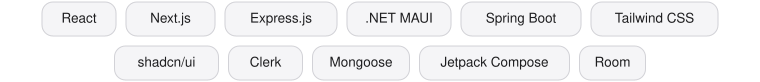

 

# Imadeddine Aït Benhammou

### Du code propre. Des applications complètes.

Étudiant en génie logiciel au Collège de Bois-de-Boulogne, Montréal.

 

 
 

**À la recherche d'un stage en développement logiciel.**

 

---

 

## Projets

 

### ChapterZero

**Plateforme de lecture et de suivi de mangas.**

Catalogue, progression de lecture, listes personnalisées et recherche avancée avec tris et filtres. Authentification OAuth/JWT, et une IA qui génère résumés et commentaires. Conçue en équipe de trois et déployée avec Docker sur Railway.

`React` `Express.js` `MongoDB` `Docker`

 

### Application de contacts

**Application Android de gestion de contacts.**

Création, modification et suppression, photo par caméra ou galerie. Données sauvegardées localement avec Room, interface en Jetpack Compose selon l'architecture MVVM. Disponible en français et en anglais, avec mode sombre.

`Kotlin` `Jetpack Compose` `Room`

 

### VAMP2 Survivors

**Jeu d'action-survie 3D.**

Le joueur affronte des vagues d'ennemis pilotés par une intelligence artificielle à états. Le projet repose sur les patrons de conception État, Observateur, Singleton et Stratégie.

`C#` `Unity`

 

### Porte d'aération de serre

**Objet connecté.**

Système embarqué sur Raspberry Pi qui contrôle l'ouverture d'une porte d'aération à partir de données de télémétrie envoyées dans Azure, avec une interface web et mobile de contrôle à distance.

`Python` `Raspberry Pi` `Microsoft Azure`

 

> Mes dépôts de projets sont privés. Pour voir le code ou une démonstration, contactez-moi.

 

---

 

## Technologies

**Langages**

 

**Cadriciels et bibliothèques**

 

**Bases de données**

 

**Outils et plateformes**

 

**Réseaux et systèmes**

 

**Méthodes et conception**

 

---

 

---

 

---

 

## Parcours

**DEC Techniques de l'informatique, profil Génie logiciel** (2023 – présent)
Agile et Scrum, UML, API REST, OAuth/JWT, objets connectés et infonuagique.

**Tuteur en informatique** au Collège de Bois-de-Boulogne (2024 – présent)
Tutorat individuel et en classe : théorie, programmation et débogage.

**Certification** Cisco CCNA 1, introduction aux réseaux.

 

*Français : excellent. Anglais : intermédiaire.*

